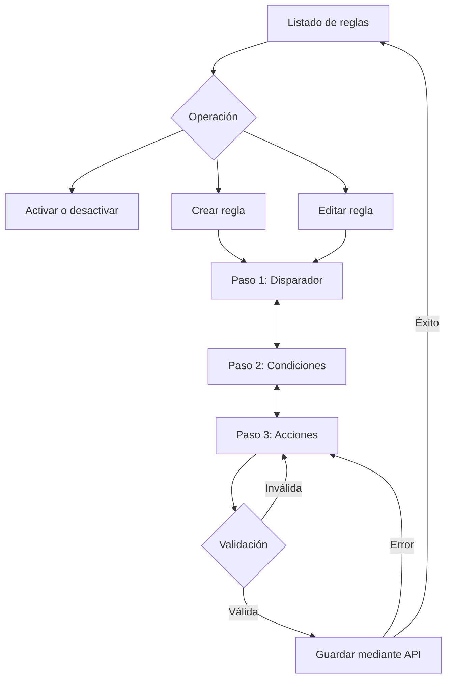

# Diseño UX — Notification Rules Builder

## 1. Objetivo

Diseñar una interfaz sencilla y accesible para crear, editar y administrar reglas de notificación.

La aplicación utiliza un listado principal y un editor de tres pasos.

## 2. Flujo principal

La navegación entre pasos conserva los datos capturados.

## 3. Pantalla principal

El listado presenta:

- Nombre de la regla.
- Disparador configurado.
- Estado activo o inactivo.
- Acción para editar.
- Botón para crear una regla.

La activación y desactivación ocurre directamente desde el listado.

En escritorio se utilizará una tabla. En dispositivos móviles se presentarán tarjetas.

## 4. Editor de reglas

### Paso 1 — Disparador

Campos:
- Nombre de la regla.
- Disparador seleccionado.

Opciones:
- Cliente creado.
- Pago recibido.
- Ticket sin respuesta.

Si cambia el disparador y existen condiciones, se solicita confirmación antes de eliminarlas.

### Paso 2 — Condiciones

Cada condición contiene:
- Campo.
- Operador.
- Valor.

Los campos dependen del disparador.

Se permite:
- Agregar condiciones.
- Eliminar condiciones.
- Reordenar condiciones.
- Combinar mediante AND u OR.
- Continuar sin condiciones.

Los operadores dependen del tipo de campo.

### Paso 3 — Acciones

Se requiere al menos una acción.

Email:
- Destinatario válido.
- Asunto.
- Cuerpo.

SMS:
- Número telefónico.
- Mensaje de máximo 160 caracteres.

Webhook:
- URL HTTP o HTTPS.
- Método POST o PUT.

Las acciones pueden agregarse y eliminarse.

## 5. Estados de interfaz

### Listado vacío

Mostrar un mensaje indicando que no existen reglas y una opción para crear la primera.

### Cargando

Mostrar un indicador de carga mientras responde la API.

### Error del servidor

Mostrar un mensaje comprensible y permitir reintentar cuando corresponda.

### Guardado exitoso

Regresar al listado y mostrar los datos actualizados.

### Error al guardar

Mantener el formulario y los datos ingresados.

### Error al cambiar estado

Conservar o restaurar el último estado confirmado por el servidor.

## 6. Validaciones

- Nombre obligatorio.
- Nombre único, verificado por el backend.
- Disparador válido.
- Cero o más condiciones.
- Condiciones existentes completas y válidas.
- Una o más acciones obligatorias.
- Email con formato válido.
- SMS con teléfono y mensaje válido.
- Webhook con URL HTTP/HTTPS y método permitido.

Los errores se muestran cerca de los campos correspondientes.

No se utilizarán alertas del navegador para validaciones habituales.

## 7. Diseño responsive

En pantallas de 768 px o más:
- Listado en tabla.
- Encabezado horizontal.
- Condiciones organizadas en filas.
- Navegación del editor horizontal.

En pantallas menores a 768 px:
- Listado mediante tarjetas.
- Controles adaptados al ancho disponible.
- Formularios y condiciones apilados.
- Indicadores compactos del editor.

La implementación utilizará un enfoque mobile-first.

## 8. Decisiones técnicas de interfaz

- React con TypeScript.
- Tailwind CSS como herramienta principal de estilos.
- BEM únicamente cuando se necesite CSS personalizado.
- HTML semántico y controles accesibles.
- Un editor reutilizable para crear y editar.
- Estado local para el borrador del editor.
- Sin incorporar librerías adicionales innecesarias.

## 9. Alcance

No se implementará ejecución real de notificaciones, autenticación ni funciones ajenas al ejercicio.

Este documento describe las decisiones aprobadas antes de implementar la arquitectura frontend.
